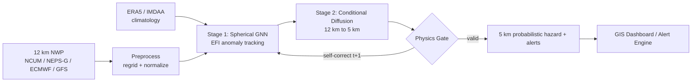

# VARUN: AI-Driven Spatio-Temporal Tracking of Extreme Weather Anomalies

**Smart India Hackathon 2026** | Problem Statement **26078** | Theme: Smart Automation | Category: Software | Team **Eklavya**

> From broad 12 km forecasts to actionable 5 km probabilistic hazard zones.

**Live demo:** https://YOUR_USERNAME.github.io/varun-sih-2026/

## Problem
IMD's operational NCUM/NEPS-G models run at ~12 km, but cloudbursts, flash floods and localized rain bands act at 1-5 km. Warnings end up district-wide while damage stays in a narrow zone (e.g. the 2023 Himachal floods). Deterministic models also smooth out extreme peaks in 3-10 day forecasts.

## Solution
A hybrid, physics-informed AI pipeline that detects, tracks and downscales extreme events into probabilistic 5 km hazard fields.



## Innovation
1. GNN tracking + diffusion downscaling + physics constraints in one pipeline
2. Extreme-focused: preserves peak amplitudes
3. Ensemble-based uncertainty with calibrated confidence
4. Self-correcting loop: validated 5 km output feeds the GNN at t+1

## Repo structure
| Path | Purpose |
|---|---|
| `docs/index.html` | Interactive prototype (GitHub Pages, synthetic data) |
| `varun/efi.py` | Extreme Forecast Index (working) |
| `varun/gnn_tracker.py` | Stage 1 tracker (placeholder, DGL model planned) |
| `varun/downscale.py` | Stage 2 downscaler (baseline, diffusion model planned) |
| `varun/physics_gate.py` | Physics validation (non-negativity, mass consistency) |
| `varun/pipeline.py`, `varun/api.py` | End-to-end run + FastAPI service |

## Run locally
```bash
pip install -r requirements.txt
python -m varun.pipeline            # demo pipeline
uvicorn varun.api:app --reload      # API at http://127.0.0.1:8000/docs
```

## Tech stack
Python, PyTorch/JAX, DGL, HuggingFace Diffusers, Xarray + Dask, MetPy, Cartopy, cfgrib, GeoPandas, Folium/Leaflet/Plotly, FastAPI, Docker.

## Roadmap
- [x] Pipeline skeleton, EFI, physics gate, demo dashboard
- [ ] Load ERA5/IMDAA and compute real EFI climatology
- [ ] Train spherical GNN tracker
- [ ] Train conditional diffusion downscaler (12 km to 5 km)
- [ ] Leaflet GIS dashboard on real forecasts + alert engine

## References
GraphCast (arXiv 2212.12794), GenCast ([2312.15796](https://arxiv.org/abs/2312.15796)), spateGAN-ERA5 ([Sci Rep 2022](https://www.nature.com/articles/s41598-022-12838-9)), IMD NWP (nwp.imd.gov.in), ERA5 (cds.climate.copernicus.eu), IMDAA (imdaa.gov.in).

## Team Eklavya
Add member names here.

License: MIT
